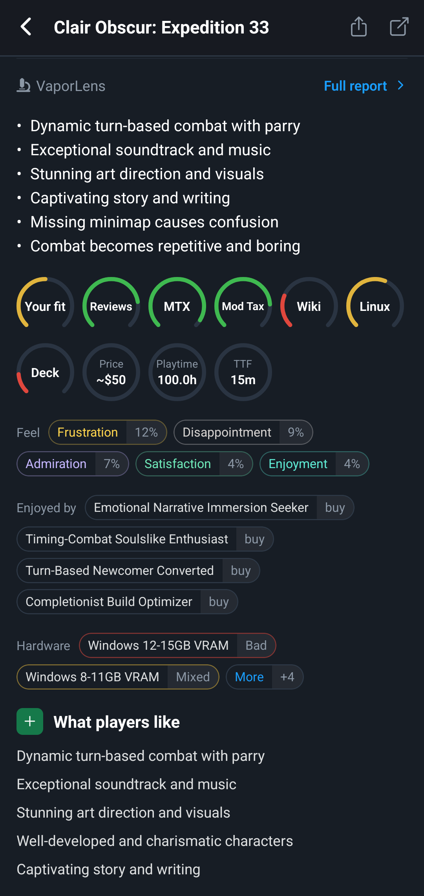
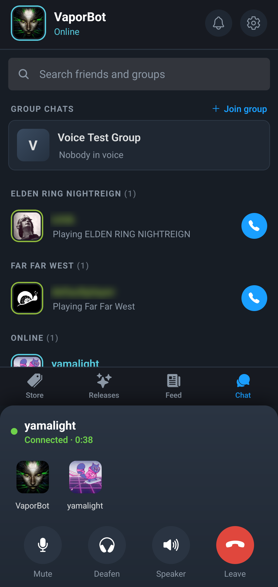
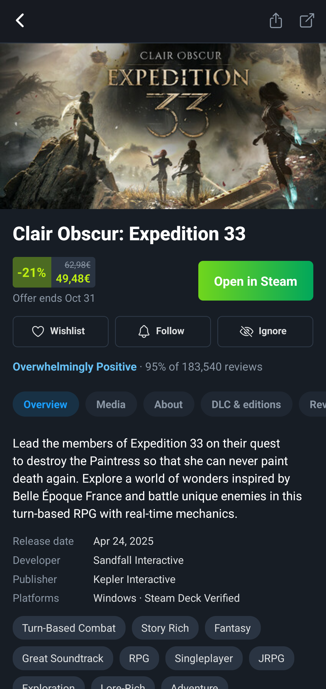

# Vaporlens

An unofficial Steam companion app for iOS and Android, with the voice chat Valve's own mobile apps
don't have: group voice channels, 1:1 friend calls, text chat, plus the Steam store, wishlist,
library, news and review summaries on every game page from [VaporLens](https://vaporlens.app), a
separate service of ours that isn't part of this repo.

<p>
  
  
  
</p>

The app talks to Steam directly over the same WebSocket connection Steam's own clients use. Your
password, messages and calls go only to Steam; see the [privacy policy](https://vaporlens.app/privacy).
Vaporlens is not affiliated with Valve. It was built with LLM assistance.

## Repository

npm workspaces:

- [`packages/vaporchat`](packages/vaporchat/README.md): the Steam client library (login, friends,
  chat, voice over WebRTC, store APIs). Runs in React Native, browsers and Node/Bun.
- [`packages/mobile`](packages/mobile): the Expo app.
- [`packages/web`](packages/web/README.md): a browser debug harness for the library.

Docs:

- [`docs/features.md`](docs/features.md): what the app does and the Steam APIs behind each feature;
  [`features-wont-do.md`](docs/features-wont-do.md) lists what it leaves out on purpose.
- [`docs/ios.md`](docs/ios.md) and [`docs/android.md`](docs/android.md): building and running the
  app. Release builds: [`docs/testflight.md`](docs/testflight.md) and the end of `android.md`.
- [`CHANGELOG.md`](CHANGELOG.md)

## Development

```sh
npm ci
npm run check   # biome + tsc
npm test        # vitest
```

The app is an Expo dev build (Expo Go can't load `react-native-webrtc`); the platform docs above
cover the toolchains. Forks that publish their own build need their own bundle id
(`org.vaporlens.Vaporlens`) and Apple team id (`EA3F6PEEAV`) wherever they appear (the
build reads them from `packages/mobile/app.json` and `packages/mobile/ExportOptions.plist`; the
docs mention them too), and their own Android upload key.

## License

[MIT](LICENSE). The Steam protobuf definitions in `packages/vaporchat/steam/protos.generated.ts`
are generated from [steam-user](https://github.com/DoctorMcKay/node-steam-user)'s definitions (MIT)
plus a few copied from [SteamDatabase/Protobufs](https://github.com/SteamDatabase/Protobufs)
(`packages/vaporchat/scripts/*.proto`).
